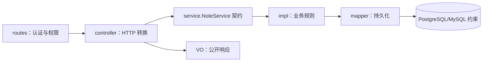

# Controller、Service、Mapper 规范与真实示例

本模板按固定 MVC 目录开发，新增资源时分别增加 `*_controller.go`、`*_service.go`、`*_service_impl.go`、`*_mapper.go`、`*_routes.go`、`*_dto.go`、`*_vo.go`。下面用已经参与编译和测试的笔记 CRUD 串起一个创建请求；代码块是实际源码摘录，完整 imports、辅助函数和其他操作请打开对应文件。

## 1. 从这些文件开始

| 层 | 规范 | 完整源码 |
|---|---|---|
| routes | [路由](../pkg/router/routes/README.md) | [note_routes.go](../pkg/router/routes/note_routes.go) |
| controller | [HTTP 控制器](../pkg/serve/controller/README.md) | [note_controller.go](../pkg/serve/controller/note_controller.go) |
| 请求 DTO | [输入字段](../pkg/serve/controller/dto/README.md) | [note_dto.go](../pkg/serve/controller/dto/note_dto.go) |
| service | [用例契约](../pkg/serve/service/README.md) | [note_service.go](../pkg/serve/service/note_service.go) |
| service/impl | [规则实现](../pkg/serve/service/impl/README.md) | [note_service_impl.go](../pkg/serve/service/impl/note_service_impl.go) |
| mapper | [SQL 写法](../pkg/serve/mapper/README.md) | [note_mapper.go](../pkg/serve/mapper/note_mapper.go) |
| model | [表结构](../internal/model/note/README.md) | [note.go](../internal/model/note/note.go)、[集中登记](../internal/model/get_all_models.go) |
| VO | [响应字段](../pkg/vo/README.md) | [note_vo.go](../pkg/vo/note_vo.go) |
| 装配 | [Container 与 provider sets](../pkg/wire/README.md) | [container.go](../pkg/wire/container.go)、[providers.go](../pkg/wire/providers.go)、[wire.go](../pkg/wire/wire.go) |

`service` 声明接口和普通 Go 输入/结果，`service/impl` 实现业务；根 `main.go` 调用 `cmd.Run` 处理进程启动。`mapper` 处理数据访问，不再并列创建同义 repository/dao。

## 2. 一次创建请求怎样经过各层



向 `POST /api/v1/examples/notes` 提交：

```json
{"slug":"first-note","title":"  第一条笔记  ","content":"正文"}
```

请求须先通过 Bearer 和写权限。路由权限控制“能不能创建”，owner 条件控制“属于谁”；管理员的 `*` 权限也不会绕过数据归属。

### Routes：用原生 Gin 声明路径与权限

下面是 [note_routes.go](../pkg/router/routes/note_routes.go) 的完整路由模块，可作为同层资源的写法参考：

```go
package routes

import (
    "healgo-scaffold/internal/middleware"
    "healgo-scaffold/pkg/wire"

    "github.com/gin-gonic/gin"
)

const NoteReadPermission = "example:notes:read"
const NoteWritePermission = "example:notes:write"

// RegisterNoteRoutes 显式声明 HTTP 方法、权限和控制器方法之间的关系
// protected 已验证身份；每个操作仍须声明权限，读取权限不隐含写入权限
func RegisterNoteRoutes(container *wire.Container, protected *gin.RouterGroup) {
    notes := container.NoteController
    group := protected.Group("/examples/notes")
    // 权限值来自代码声明，不允许调用方通过请求参数选择要检查的权限
    // 缺少身份由 protected 拒绝，身份成立但没有权限由 Permission 返回 403
    read := middleware.Permission(container.Auth, NoteReadPermission)
    write := middleware.Permission(container.Auth, NoteWritePermission)
    // 所有数据操作仍将 Principal.ID 传到服务与查询；路由权限不替代 owner 隔离
    group.POST("", write, notes.Create)
    group.GET("", read, notes.List)
    group.GET("/:id", read, notes.Get)
    group.PUT("/:id", write, notes.Update)
    group.DELETE("/:id", write, notes.Delete)
}
```

中央 [router.go](../pkg/router/router.go) 的 `New(engine, container)` 只创建公共、受保护分组并调用模块登记函数。以下是已有登记区的结构，位于该函数内部：

```go
public := engine.Group("/api/v1")
protected := engine.Group("/api/v1", middleware.Authenticate(container.Auth))
routes.RegisterSystemRoutes(container, public, protected)
if container.EnableExamples {
    routes.RegisterNoteRoutes(container, protected)
    routes.RegisterRealtimeRoutes(container, public, protected)
}
```

`router.NewEngine(container)` 先建立带通用中间件、健康检查的引擎，然后 `router.New(engine, container)` 登记模块。新增资源继续使用 Gin 的 `Group/GET/POST/PUT/DELETE`，在中央入口增加对应 `Register...` 调用。Container 仅到达装配和路由层；模块从容器选择已构造的 Controller，Controller 与 Service 继续使用各自明确的窄依赖。

### Controller：只把 HTTP 翻译成用例

以下摘自 [note_controller.go](../pkg/serve/controller/note_controller.go)。构造函数接收接口，不接收 DB、具体实现或整个 Container。

```go
type NoteController struct{ service service.NoteService }

func NewNoteController(notes service.NoteService) *NoteController {
    return &NoteController{service: notes}
}
```

Create 的关键代码摘录如下，辅助函数见完整文件：

```go
owner, ok := ownerID(c)
if !ok {
    return
}
var input dto.CreateNoteRequest
```

```go
if !response.BindJSON(c, &input) {
    return
}
note, err := h.service.Create(c.Request.Context(), owner, service.CreateNoteInput{
    Slug: input.Slug, Title: input.Title, Content: input.Content,
})
if err != nil {
    fail(c, err)
    return
}
response.Write(c, http.StatusCreated, vo.FromNoteModel(note))
```

身份来自认证 Principal，不能从正文的 `owner_id` 推导。`BindJSON` 拒绝未知字段；DTO 只声明可写字段。PUT 用指针区分“没有提交 content”和“明确提交空字符串”，不把缺失误当清空。controller 将稳定错误映射为 400/404/409/503，不回显原始错误。

### Service：契约与实现分开

[service/note_service.go](../pkg/serve/service/note_service.go) 声明实际用例接口：

```go
type NoteService interface {
    Create(context.Context, uint64, CreateNoteInput) (model.Note, error)
    Get(context.Context, uint64, uint64) (model.Note, error)
    List(context.Context, uint64, int, int) (NotePage, error)
    Update(context.Context, uint64, uint64, UpdateNoteInput) (model.Note, error)
    Delete(context.Context, uint64, uint64, uint64) error
}
```

同一文件声明使用方需要的 `NoteMapper` 窄接口及 `CreateNoteInput`、`UpdateNoteInput`、`NotePage`，不导入 Gin/GORM。实现放在 [service/impl/note_service_impl.go](../pkg/serve/service/impl/note_service_impl.go)：

```go
func NewNoteService(mapper service.NoteMapper) service.NoteService {
    return &NoteServiceImpl{mapper: mapper}
}
```

```go
func (s *NoteServiceImpl) Create(ctx context.Context, ownerID uint64, input service.CreateNoteInput) (model.Note, error) {
    // 标题允许正常排版空白，但持久化前规范首尾空白，让长度规则和展示结果一致
    input.Title = strings.TrimSpace(input.Title)
    // Slug 不自动改写：悄悄转小写或删字符会把用户输入合并成同一个唯一地址
    if !validID(ownerID) || len(input.Slug) < 1 || len(input.Slug) > 64 || !slugPattern.MatchString(input.Slug) || !validText(input.Title, input.Content) {
        return model.Note{}, service.ErrInvalidInput
    }
    if s == nil || s.mapper == nil {
        return model.Note{}, service.ErrUnavailable
    }
    return s.mapper.Create(ctx, model.Note{OwnerID: ownerID, Slug: input.Slug, Title: input.Title, Content: input.Content, Revision: 1})
}
```

`validID`、`validText`、`slugPattern` 也在完整源码中。标题去两端空白后为 1–120 字符，正文允许空、最多 10000 字符，拒绝 NUL/非法 UTF-8；slug 只允许小写字母、数字和词间连字符。这些规则对 HTTP、任务和命令行调用同样有效。service/impl 不读取 Gin Context，也不拼 SQL。

### Mapper：带 ctx、owner 和约束执行 SQL

以下摘自 [note_mapper.go](../pkg/serve/mapper/note_mapper.go)：

```go
func NewNoteMapper(database *gorm.DB) (*NoteMapper, error) {
    if database == nil {
        return nil, model.ErrInvalidInput
    }
    return &NoteMapper{database: database}, nil
}
```

```go
func (m *NoteMapper) Create(ctx context.Context, note model.Note) (model.Note, error) {
    // ID 与版本由持久化入口固定，调用者不能通过“创建”覆盖已有资源
    note.ID = 0
    note.Revision = 1
    if err := m.database.WithContext(ctx).Create(&note).Error; err != nil {
        return model.Note{}, safeError(ctx, err)
    }
    return note, nil
}
```

`WithContext` 向驱动传播取消与期限。Get/List/Update/Delete 的 SQL 都保留 owner 范围，不先读出他人记录再由 controller 过滤。模型的 `(owner_id, slug)` 唯一约束处理并发重复创建；`safeError` 将驱动错误转换为稳定类别，具体参数和 SQL 不跨层外泄。

更新用 map 明确写入空正文；owner、ID、revision 比较与 revision 自增在同一 SQL 完成。PostgreSQL 用 `RETURNING`，MySQL 在同事务内带锁回读本次修改的行；`RowsAffected == 0` 固定主库区分不可见/不存在与版本冲突。完整代码与解释见 [mapper 规范](../pkg/serve/mapper/README.md)。

### VO：只公开明确选择的字段

[vo.FromNoteModel](../pkg/vo/note_vo.go) 显式复制 ID、slug、标题、正文、revision 和时间，不公开 owner。ID 用 JSON 字符串避免浏览器大整数舍入，分页空 Items 保持 `[]`。请求 DTO、服务输入、表模型和响应 VO 有不同的职责，不能全部复用表实体。

## 3. 默认 Wire 注入，按层登记构造函数

默认 `wire.NewContainer(ctx, cfg, opts)` 调用生成的 `buildWithWire`。在 [providers.go](../pkg/wire/providers.go) 按层登记已有的 Note 构造函数和接口绑定：

```go
var MapperProviders = wire.NewSet(
    mapper.NewNoteMapperWithReader,
    wire.Bind(new(service.NoteMapper), new(*mapper.NoteMapper)),
)

var ServiceProviders = wire.NewSet(
    impl.NewNoteService,
)

var ControllerProviders = wire.NewSet(
    controller.NewNoteController,
    provideSystemController,
    provideRealtimeController,
)
```

这些声明使用 providers.go 已有的 imports 和 `wireinject` 标签。`wire.Bind` 将具体 Mapper 绑定到 Service 声明的接口；`impl.NewNoteService` 已返回 `service.NoteService`，Controller 的参数仍是该接口。

在 [Container](../pkg/wire/container.go) 为路由保留 `NoteController *controller.NoteController` 字段，[wire.go](../pkg/wire/wire.go) 使用字段装配：

```go
panic(wire.Build(
    AllProviders,
    wire.Struct(new(bootstrap.Resources), "*"),
    wire.FieldsOf(new(bootstrap.Options), "EnableExamples"),
    wire.Struct(new(Container), "*"),
))
```

这是已有 injector 函数体。Wire 依据字段类型推导对象；生命周期字段 `cleanup`、`closeOnce` 标记 `wire:"-"`，由公共收尾管理。完整字段和 injector 签名见 [扩展手册](EXTENDING.md#3-默认-wire-注入与可选手写装配)。增加 Controller 字段及按层 provider 后执行 `go generate ./pkg/wire`，不手改 wire_gen.go。

`NewContainer` 完成资源与对象构造，再统一 Prepare；构造函数不能查表、建表、启动后台任务。Container 已完成模型和种子后，CLI 调用 `router.NewEngine(container)`，再调用 `router.New(engine, container)`，最后创建 Runtime。默认入口也构造示例对象，但只有 `EnableExamples` 开启时才登记示例表与路由。

可选手写入口为 `NewContainerManual(ctx, cfg, opts)`。在 [manual.go](../pkg/wire/manual.go) 的 `buildManual` 中可直接看到相同的构造关系，新增依赖时按顺序构造，再写入该文件的 Container 字面量：

```go
noteMapper, err := mapper.NewNoteMapperWithReader(cluster)
if err != nil {
    return nil, nil, err
}
noteService := impl.NewNoteService(noteMapper)
noteController := controller.NewNoteController(noteService)
```

`cluster.Primary` 是普通主库连接。`NewNoteMapperWithReader` 仅让 List 显式通过 Cluster.Read，其他方法固定主库；没有副本时 List 也走主库。事务内使用上面的 `NewNoteMapper(tx)`，所有操作都绑定该 tx。新增资源如何选择一致性和连接见 [数据库手册](DATABASE.md)。

默认 CLI 为 `-di wire`，`-di manual` 选择手写路径。两者使用相同构造函数与 Prepare，只有一张 Wire 图。

## 4. 新增资源时的最短顺序

1. 在 `internal/model/<资源>/` 定义表和约束，并在 `get_all_models.go` 登记。
2. 在 `controller/dto/<资源>_dto.go` 和 `pkg/vo/<资源>_vo.go` 明确允许输入和公开输出。
3. 在 `service/<资源>_service.go` 声明用例、输入/结果、所需 mapper 接口，在 `service/impl/<资源>_service_impl.go` 实现规则。
4. 在 `mapper/<资源>_mapper.go` 实现持久化；在 controller 适配身份、ctx、错误与 VO。
5. 在 Container 增加 Controller 字段，在各层 provider 登记构造函数与接口绑定；在 `routes/<资源>_routes.go` 声明原生 Gin 路径/权限，再由中央入口调用模块登记函数。
6. 执行 `go generate ./pkg/wire`；使用手写路径时同步 manual.go 的构造与 Container 字面量。使用同样配置 migrate、serve，验证主流程、401/403、归属、非法输入、唯一约束和版本冲突。

事务共享 tx、具体接入点和可编辑配置见 [扩展手册](EXTENDING.md)。当前场景能演示、权限和数据边界通过后即可结束，不用先增加缓存或消息队列。

## 5. 运行与验证

先按 [开发手册](DEVELOPMENT.md#1-先把示例运行起来)准备数据库与私有 YAML（默认演示 PostgreSQL）：

```powershell
go run ./cmd/example migrate -config configs/config.local.yaml
go run ./cmd/example serve -config configs/config.local.yaml -di wire
# 停止后也可用 -di manual 启动，验证相同 HTTP 行为
```

```powershell
go test ./pkg/serve/service/impl ./internal/model/note -count=1
go generate ./pkg/wire
go tool wire diff ./pkg/wire
go test ./pkg/serve/mapper ./pkg/router/... ./pkg/wire -count=1
go build -o .build/healgo-example ./cmd/example
```

impl/model 单元测试不需要数据库；mapper、HTTP 和 Container 集成测试使用 `HEAGO_TEST_DATABASE_URL` 或 `HEAGO_TEST_MYSQL_DSN`，两个驱动分别运行，未设置时的 skip 不能算真实数据库验证。完整登录、CRUD、409 和删除脚本见 [开发手册](DEVELOPMENT.md)。
